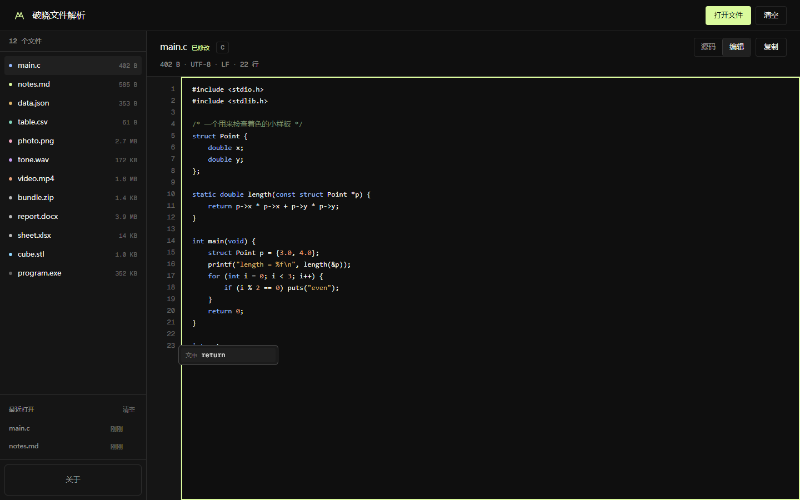
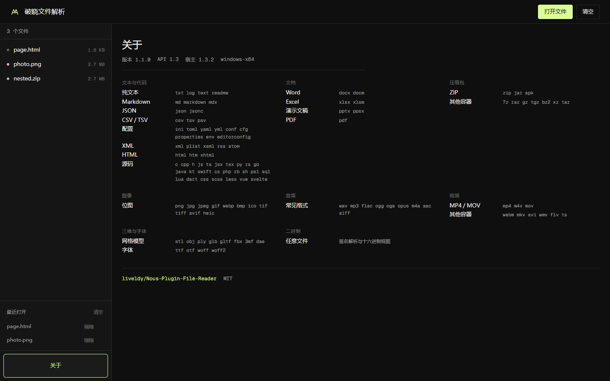
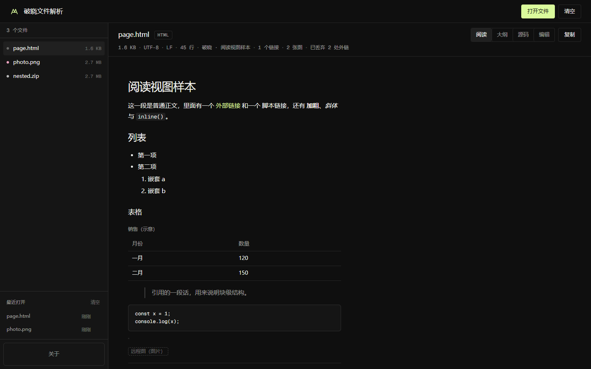

# 破晓文件解析阅读器

Nous 插件（`app.nous.file-reader`）。一个窗口读完手上的文件：文本与代码、Markdown、JSON、CSV、配置、图像、音频、视频、压缩包、Office 文档、PDF、三维模型和任意二进制。能渲染的地方就渲染，需要改的地方带编辑器，读不懂的地方给结构统计和十六进制。



## 能力

| 类别 | 识别 | 能做什么 |
| --- | --- | --- |
| 文本 / 源码 | 扩展名 + 魔数 | 20 多种语言的着色、行号、源码与编辑两种视图；编辑带缩进、括号配对、关键字 / 片段 / 文中标识符补全 |
| Markdown | `md` `markdown` | 阅读视图（标题、列表、代码、表格、引用），源码与编辑视图 |
| JSON | `json` | 可折叠结构树，带类型着色与计数 |
| CSV / TSV | `csv` `tsv` | 虚拟滚动的表格视图，数字右对齐 |
| INI / TOML / YAML | 扩展名 | 分节的结构视图 |
| HTML | 扩展名 | 阅读视图（按白名单重建版式）、大纲、源码、编辑 |
| XML | 扩展名 | 大纲视图 |
| 图像 | 魔数 + 扩展名 | 适应窗口 / 1:1、滚轮缩放、拖动平移、旋转、水平镜像、矩形裁剪、还原 |
| 音频 | 魔数 | 解码成波形、播放、拖动圈选片段、循环试听 |
| 视频 | ISO BMFF | 用 WebCodecs 解码上屏，播放、跳转、设入点出点 |
| 压缩包 | ZIP 签名 | 目录列表、逐条解压预览（文本看源码、其余看十六进制）；ZIP 能把当前条目或全部条目解到左侧文件列表，再按类型打开 |
| Office | `docx` `xlsx` `pptx` | 抽正文段落与表格；表格按工作表分页，单元格悬停看全文 |
| PDF | `%PDF-` | 解析对象与流，抽文本层（扫描件按未抽到处理） |
| 三维 | STL / OBJ / PLY / GLB | 三角面数、包围盒、顶点统计；低面数画面片，高面数画点云，拖动旋转 |
| 二进制 | PE、ELF、Mach-O、PNG、JPEG、GLB 等签名 | 架构、节区、子系统、可打印字节比例等事实，加上分块虚拟滚动的十六进制视图，可按偏移跳转 |

一次可以放进多个文件，左侧列表里随时切换；拖进来也行，`Ctrl+O` 打开文件选择器。打开过的文件记进左下角「最近打开」，随宿主 `storage` 保留到下次启动，可逐条删除或清空。侧栏的「关于」列出支持的类型，以及插件、接口与宿主版本。



## 这个宿主环境里做不到的事

宿主把插件页关在 `sandbox="allow-scripts allow-forms"` 的 iframe 里，CSP 是 `default-src 'none'`。这决定了几件事，界面上也照实说明：

- **不能另存文件**：`showSaveFilePicker` 抛 `SecurityError`，`<a download>` 被沙箱拦掉。编辑结果要通过“复制”带走，或者自己回原文件改。
- **不能开 iframe**：`frame-src 'none'`，所以 HTML 的阅读视图不是把页面跑起来，而是按白名单重建一份静态结构——标题、段落、列表、表格、引用、代码、内联 `data:` 图片和 https 链接留下，脚本、外链样式、表单与远程资源一律丢掉。阅读视图的元信息行会如实写出丢了多少处。
- **解压的出口是文件列表**：沙箱没有写盘通道，ZIP 解出来的条目作为内存文件加进左侧列表（单次上限 64 MB / 300 条），用现成的视图打开。
- **剪贴板走宿主接口**，一次上限 30000 字符，超出会提示而不是静默截断。
- **`<audio>` / `<video>` / `blob:` 全部不可用**：音频用 `decodeAudioData` 解成 PCM 画波形、用 Web Audio 播放；视频走 `VideoDecoder` + canvas 上屏，所以只支持 MP4/MOV 容器里设备能解的编码（H.264 / HEVC / AV1 / VP9 + AAC），超过 512 MB 的文件不解码。
- **一切解析都在本地**，不发网络请求；外链通过 `external.open` 交给系统浏览器。



## 开发与自检

需要 Node 22+，`npm` 只用来跑脚本，没有运行时依赖。

```bash
node sdk/check.mjs .            # 清单、权限、协议、资源清单
node test/parsers.test.mjs      # 解析层单元测试（检测、解码、着色、Markdown、JSON/CSV、MP4）
node sdk/pack.mjs .             # 出 dist/app.nous.file-reader-1.1.0.nous-plugin.json
node tools/assert-size.mjs      # 体积 ≤ 4 MiB、资源 ≤ 256、清单与包内文件一致，并打印 SHA-256
node tools/harness.mjs dark     # 用宿主的 pluginDocument 生成 dist/document.html 与同构沙箱页
node tools/serve.mjs 8123       # 起个本地静态服务看 ui/
```

`npm run verify` 把前三步一次跑完。

`tools/harness.mjs` 会照着宿主 `PluginPage.tsx` 的握手顺序（`frame.ready` → `render` → `rendered` → `init`）把打包产物装进一个带同款 CSP 和 `sandbox` 的 iframe 里，父页负责回答 `clipboard.write`、`storage.*`、`external.open`、`host.info`，所以本机就能验证剪贴板、主题、最近打开的读写和窄窗口表现，不用装进客户端。检查台的 `storage` 用 `localStorage` 兜着，刷新页面就能看「最近打开」是不是真的留下来了。

## 目录

```
manifest.json          插件清单（id、版本、权限、资源列表）
ui/                    随包页面：index.html、style.css、app.js、lib/ 下的解析与视图模块、fonts/
sdk/                   公开插件 SDK 的本地副本（check / pack / protocol / contract）
tools/harness.mjs      与宿主同构的本机检查台
tools/serve.mjs        本地静态预览
test/parsers.test.mjs  解析层单元测试
docs/                  设计说明与界面截图
```

细节取舍写在 `docs/design.md`：怎么在没有 `<video>` 的环境里播视频，怎么在 4 MiB 的包里塞下 14 个解析模块，以及界面在设计检查里的豁免项。

## 许可

MIT，见 `LICENSE`。界面字体 Geist 与 Geist Mono 由 Vercel 以 SIL OFL 1.1 发布，许可证随包放在 `ui/fonts/OFL.txt`。
